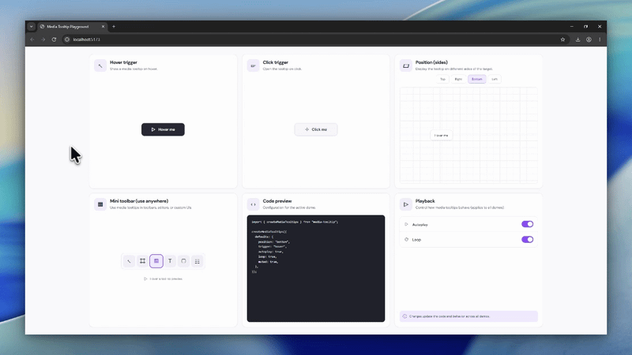

 <div align="center">
  
</div>

# media-tooltip

Lightweight video tooltips for the web.

## Demo

<div align="center">
  
</div>


## Installation

```bash
npm install media-tooltip
```

## Usage

### Data attributes

Attach a video preview to any HTML element using `data-tooltip-media`.

```html
<button data-tooltip-media="/videos/preview.mp4">
    Preview
</button>
```

Initialize the library:

```javascript
import { createMediaTooltips } from "media-tooltip";

const tooltips = createMediaTooltips();
```

Elements matching `[data-tooltip-media]` are automatically detected and initialized. Newly added matching elements are also detected.

### JavaScript API

Create a tooltip instance by passing a target element or selector and its options.

```javascript
import { tooltip } from "media-tooltip";

const preview = tooltip("#preview-button", {
    media: "/videos/preview.mp4",
    trigger: "hover",
    position: "top",
    width: 300
});
```

Control the tooltip instance:

```javascript
preview.show();
preview.hide();
preview.destroy();
```

## Features

- Video previews in tooltips
- Automatic initialization through HTML data attributes
- Hover and click triggers
- Dynamic DOM element detection
- Configurable positioning and dimensions
- Lazy video loading
- Keyboard and touch interactions
- Reduced-motion support
- ARIA accessibility attributes
- Loading and playback error handling
- Custom callbacks
- TypeScript definitions
- ESM and CommonJS builds

## Browser Support

Tested:
- Chrome
- Firefox
- Microsoft Edge


## License

See [LICENSE](./LICENSE) for details.